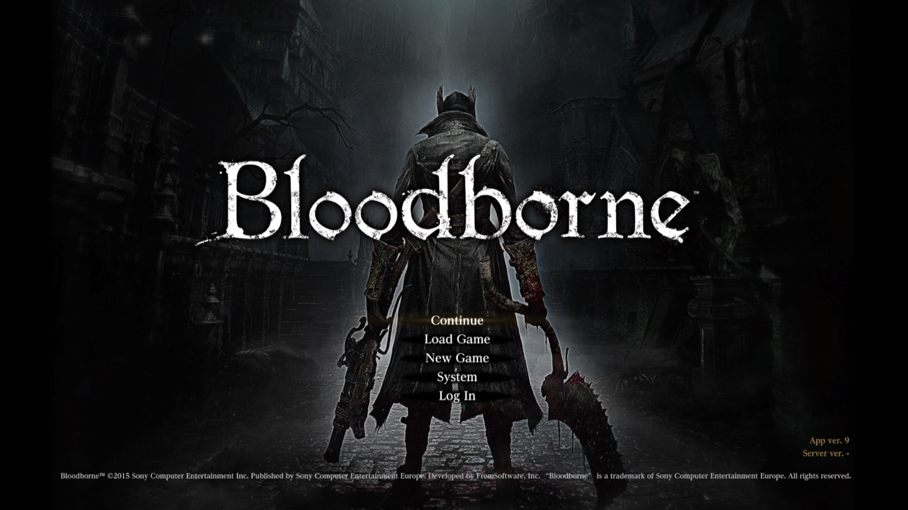
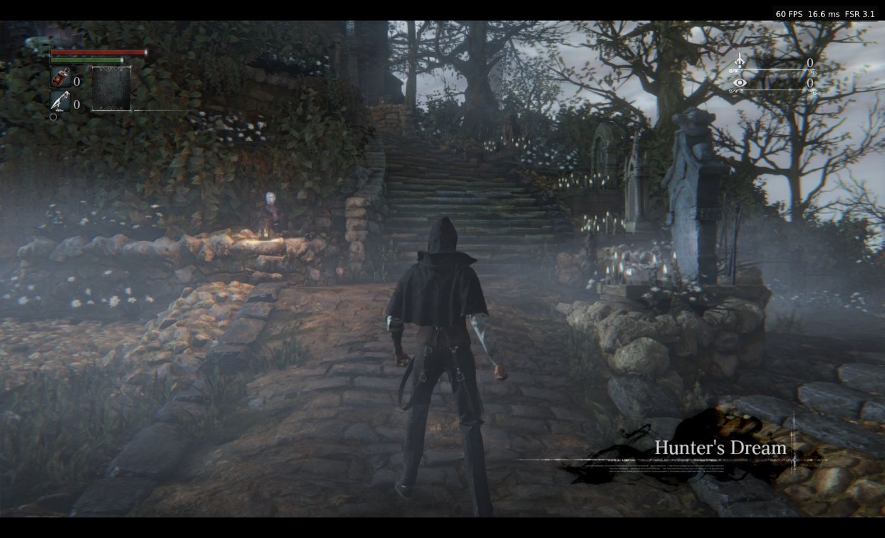
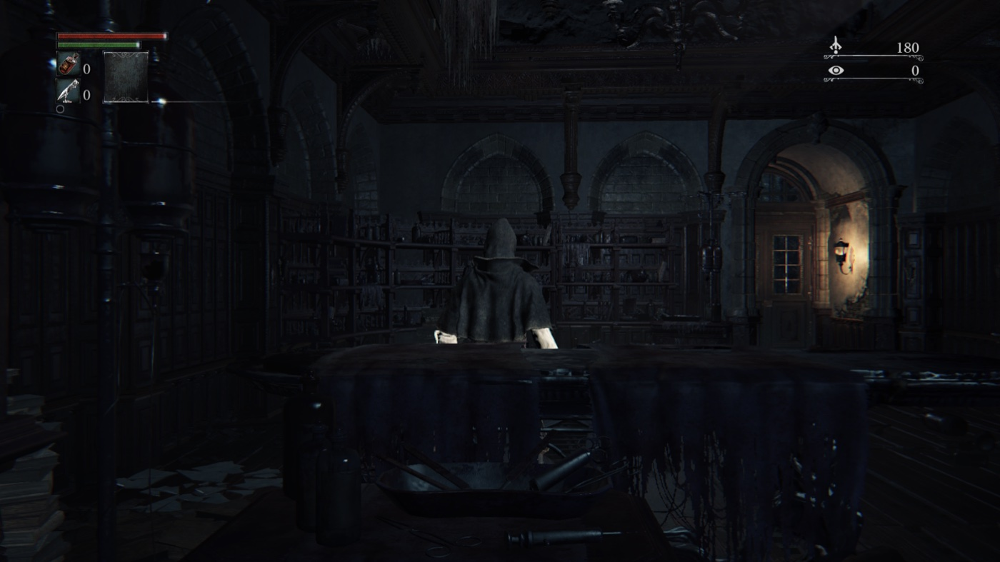
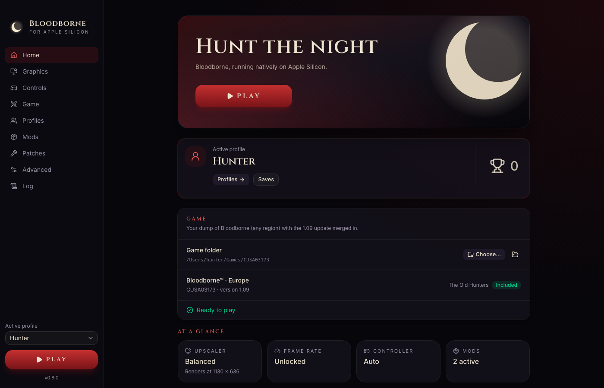
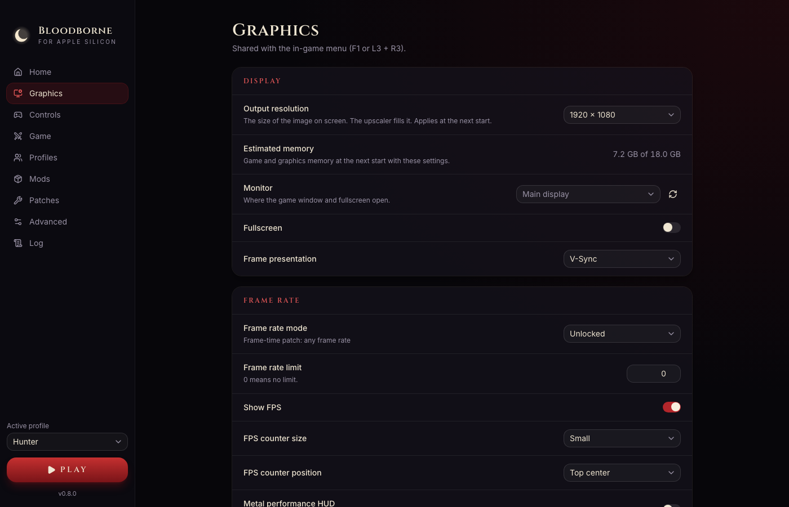

<h1 align="center">bloodborne-mac</h1>

  <strong>Bloodborne, running natively on Apple Silicon.</strong> 
  A macOS port of the PS4 game, with a launcher app and an in-game settings menu. No Rosetta 2.

  Built on <a href="https://github.com/deadinside28/bloodborne_pc"><strong>bbport</strong></a> by deadinside28, the native Linux port it started from, and on <a href="https://github.com/shadps4-emu/shadPS4">shadPS4</a>.

> [!IMPORTANT]
> **This is an experimental project. Expect bugs and regressions.**
>
> We are developing our own CPU recompiler and native renderer, with many approaches and changes
> that diverge from the original bbport. These experiments can make this project less stable than
> other Bloodborne projects. Crashes, loading hangs and graphical corruption are known risks
> during development.
>
> **Our goal is to make Bloodborne run natively**, with native CPU execution and a shared renderer
> for Vulkan and Metal. This is an independent development effort beyond porting bbport to macOS.
>
> For the dedicated macOS port of bbport, see **[bmy/bbport-mac](https://github.com/bmy/bbport-mac)**.
> It is a separate project and also describes itself as experimental. Please report problems with
> bloodborne-native [here](https://github.com/bloodborne-native/bloodborne-mac/issues).

  <a href="https://github.com/bloodborne-native/bloodborne-mac/releases/latest"><strong>Download</strong></a>
  ·
  <a href="docs/guide/installation.md">Installation</a>
  ·
  <a href="docs/README.md">Documentation</a>
  ·
  <a href="https://github.com/bloodborne-native/bloodborne-mac/issues">Report a problem</a>

  

  
  

  
  

  
  

> [!IMPORTANT]
> **No game files are included.** You need your own dump of Bloodborne with the 1.09 update.
> See [Game files](docs/guide/game-files.md).

## Features

- **Native on Apple Silicon:** the game's x86-64 code is translated to arm64 as it runs.
- **One app, nothing else to install:** download, open, choose your game folder, play.
- **A launcher** ([bloodborne-launcher](https://github.com/bloodborne-native/bloodborne-launcher)) with graphics, controls, game options, mods, patches and the game's log.
- **AMD FSR 3.1 upscaling,** the biggest performance gain on Apple GPUs.
- **An in-game settings menu** (F1, or L3 + R3 on a controller).
- **Controllers and keyboard,** with button mapping for both.
- **Mods and patches,** with load order. The game folder is never changed.
- **20 languages** for the launcher and the menu, the same as the PS4 game.

## Getting started

1. [Download the latest release](https://github.com/bloodborne-native/bloodborne-mac/releases/latest)
   and drag **Bloodborne** to Applications.
2. The first time, right-click the app and choose **Open** (the app is not signed with an Apple
   Developer ID).
3. Choose your game folder and press **Play**.

The [installation guide](docs/guide/installation.md) has the details.

## Status

**Experimental, playable.** The game boots, loads saves and plays with sound, controllers and
saving. On an Apple M3 Pro at 1080p with FSR 3.1 it runs at about **60 FPS** in the Hunter's Dream
and about **44 FPS** in the clinic at the start of the game
([performance](docs/guide/performance.md)). Only one machine has been tested so far: results on
other Macs are welcome.

**New in 0.7.0:** the stretched geometry (vertex explosions), missing walls, black sky and
objects popping in that appeared after playing for a while are fixed: MoltenVK misread game data stored past 4 GB in the GPU's
view of the game's memory. The launcher records trophies per profile, with an optional
in-game notification. See [Release notes](docs/releases/v0.7.0.md) for details and checks.

**Known issues:** in 0.7.0 the game can crash with character motion vectors on (a GPU "Invalid
Resource" error); turn them off if it does. Fixed on development main for the next release.
See [Troubleshooting](docs/guide/troubleshooting.md#known-issues).

## Documentation

| | |
|---|---|
| [Installation](docs/guide/installation.md) | Download, first start, where your data lives |
| [Game files](docs/guide/game-files.md) | Preparing your dump, supported editions, The Old Hunters |
| [Settings](docs/guide/settings.md) | The launcher, the in-game menu, languages, controllers |
| [Mods and patches](docs/guide/mods-and-patches.md) | Installing mods and third-party patches |
| [Performance](docs/guide/performance.md) | What to expect, and the settings that matter |
| [Troubleshooting](docs/guide/troubleshooting.md) | Common problems and known issues |

## Under the hood

The app is built from four repositories:

| Repository | |
|---|---|
| **bloodborne-mac** (this one) | The macOS app: packaging, releases, player guides |
| [bloodborne-launcher](https://github.com/bloodborne-native/bloodborne-launcher) | The independent launcher source, included here as `launcher/` |
| [bloodborne-runtime](https://github.com/bloodborne-native/bloodborne-runtime) | Loads the game: the PS4 system libraries and the Vulkan renderer (MoltenVK), here as `runtime/` |
| [bloodborne-recomp](https://github.com/bloodborne-native/bloodborne-recomp) | bbcpu, which translates the game's x86-64 code to arm64 as it runs, and the recompiler (`runtime/recomp/`) |

**The recompiler** turns the game's code, from the player's own copy, into native code ahead of
time, checked against calls recorded from the original. Every one of the game's functions is
generated and the game runs on them; the work now is making that faster than the translator.
Only the tool is published, never the game's code
([status](https://github.com/bloodborne-native/bloodborne-recomp/wiki/Recompilation-status)). The
recompiler and its CPU layer don't depend on macOS: other platforms can build on them.

[Building from source](docs/guide/building.md) · [How it works](docs/guide/how-it-works.md)

## Credits

Built on [**bbport**](https://github.com/deadinside28/bloodborne_pc) by deadinside28, the native
Linux port this project started from as a fork, and on [**shadPS4**](https://github.com/shadps4-emu/shadPS4):
the loader, the PS4 runtime, the renderer and its extensions, the upscalers and the game patches
come from them, and bbport's releases keep being merged (now 0.51). This work adds the macOS
platform layer, the arm64 translator, the app and the recompiler. None of it would exist without
the projects it is built on. Full list: [Credits and licenses](docs/CREDITS.md).

Licensed under the [GNU GPL v2 or later](LICENSE).

Not affiliated with shadPS4, Sony Interactive Entertainment, FromSoftware or AMD. Please do
not report problems with this project to shadPS4 or to bbport.
