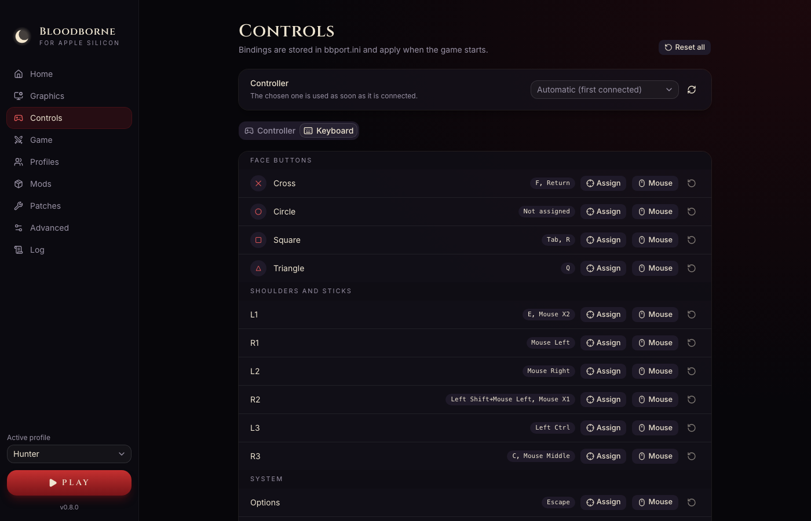
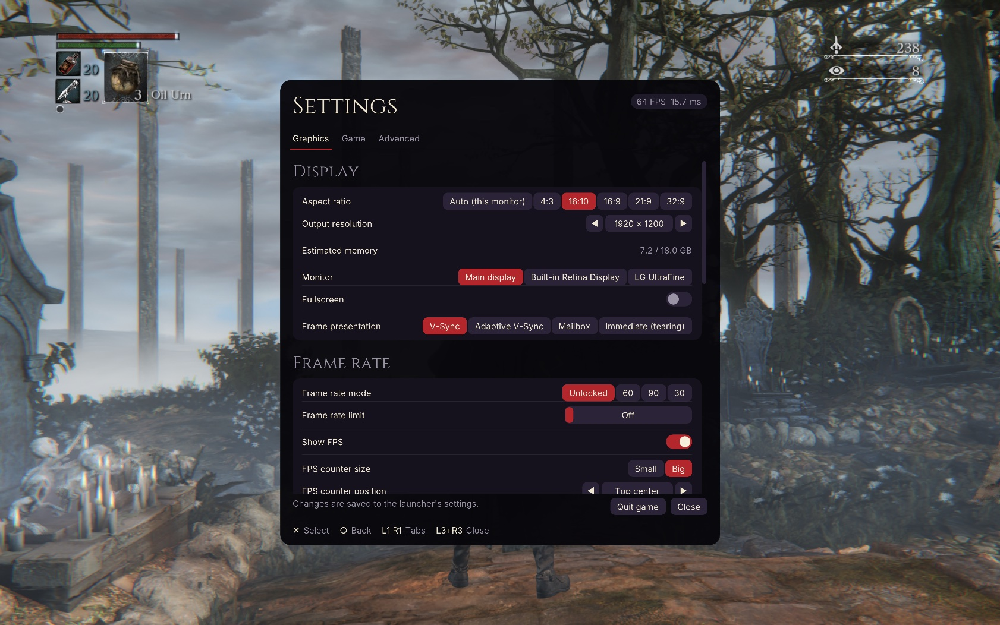

# Settings

[← Documentation](../README.md)

Renderer and game-patch options can be changed in the launcher before starting, or in the
in-game menu while playing. These options share `bbport.ini`, so a change in one shows up in
the other. Launcher startup options use `launcher.json`; profile ownership uses SQLite.

## The launcher

| Tab | What it has |
|---|---|
| **Home** | The active profile and recorded trophies, shortcuts to Profiles/Saves, game folder, edition/readiness and a summary of the main settings |
| **Graphics** | Output resolution, monitor, fullscreen, frame presentation (V-Sync), frame-rate mode/limit, FPS counter, upscaling and sharpening, motion vectors, model detail and visual effects |
| **Controls** | Which controller to use, and button mapping for controller and keyboard |
| **Game** | Game language, skipping intro videos and the active profile’s save-folder location |
| **Profiles** | First-profile setup, fresh profile creation, rename, active selection and confirmed deletion (0.6.0) |
| **Saves** | The active profile’s save set, backups and restore. See [Profiles and saves](saves.md) (0.6.0) |
| **Mods** | Mods and their load order. See [Mods and patches](mods-and-patches.md) |
| **Patches** | Third-party game patches. See [Mods and patches](mods-and-patches.md) |
| **Advanced** | Launcher language and hiding during gameplay, new-version checks, experimental performance options, free camera/debug menu, diagnostics, extra environment variables and the data folder |
| **Log** | The game's output while it runs |

The Home frame-rate shortcut opens Graphics. The Game save-folder row shows the active
profile's location; use Profiles to change the active identity. Saves keeps backup/restore. Backup-folder access is under Advanced → Data. Low-level and experimental renderer options remain in Advanced.
These tab changes are included in 0.6.0.

## The in-game menu

Press **F1** on the keyboard, or **L3 + R3** on a controller, to open the settings menu over the
game. Most graphics settings apply right away. Settings that need a restart say so, and the menu
has a button to restart the game.

## Languages

The launcher and the in-game menu are available in the 20 languages of the PS4 game:

English, Português (Brasil), Português (Portugal), Español (España), Español (Latinoamérica),
Français, Deutsch, Italiano, Nederlands, Polski, Русский, Türkçe, Suomi, Svenska, Dansk, Norsk,
日本語, 한국어, 简体中文 and 繁體中文.

- **Hide launcher during gameplay:** Advanced → Launcher. Enabled by default; turn off to keep the Log tab visible. Changes apply during gameplay.
- **Launcher language:** Advanced → Launcher language. By default it follows macOS.
- **In-game menu:** follows the launcher's language.
- **Game language** (the game's own text and voices): Game → Language. Every language the PS4
  version offers can be chosen, Portuguese included.

## Recommended settings

On Apple Silicon the game is limited by the GPU, so upscaling gives the largest gain:

- **Upscaler:** FSR 3.1 with the *Balanced* or *Performance* preset.
- **Character motion vectors:** off (the default on macOS). They improve FSR on moving characters
  but cost about 5 ms per frame on Apple GPUs.

With a 1080p output, the upscaler preset sets the resolution the whole game renders at from the
start, so changing the preset needs a restart.

See [Performance](performance.md) for measurements.

## Controllers

Controllers work through SDL3: PlayStation, Xbox and other common controllers are recognized.
Without a controller, the keyboard can be used; its keys can be remapped on the **Controls** tab.

## New-version notifications

The launcher in 0.6.0 checks stable app releases on GitHub and shows a dismissible banner
when a newer version is available. Advanced includes automatic checks and **Check now**;
downloads and installation remain manual. See [Updates](updates.md).
